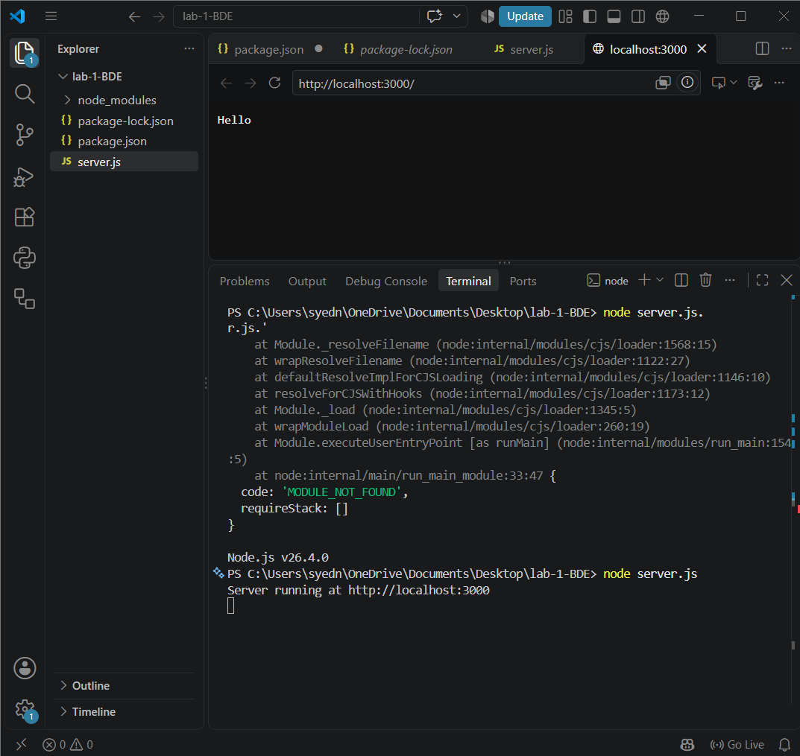
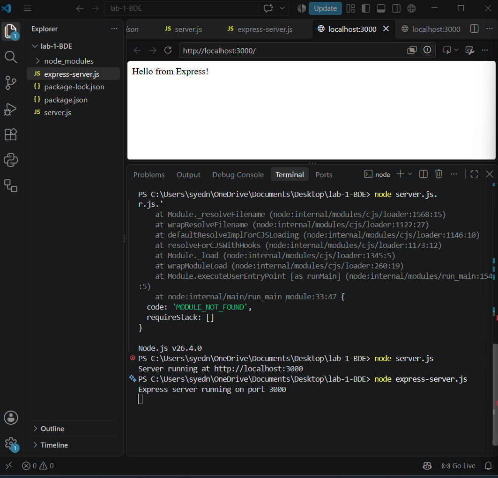
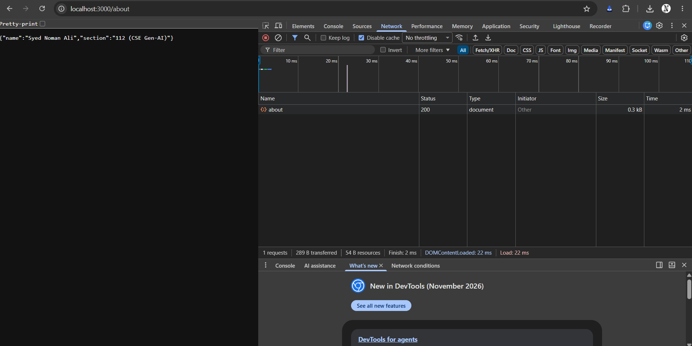
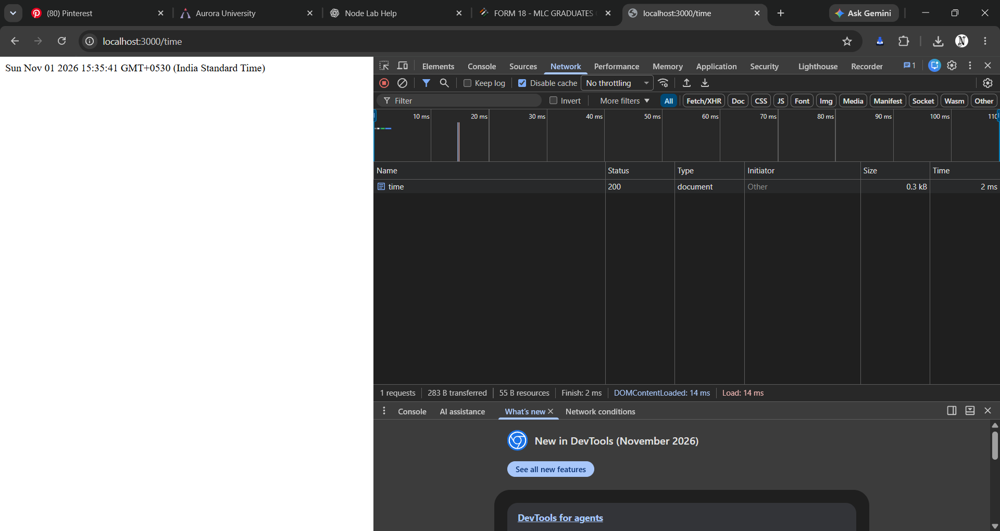
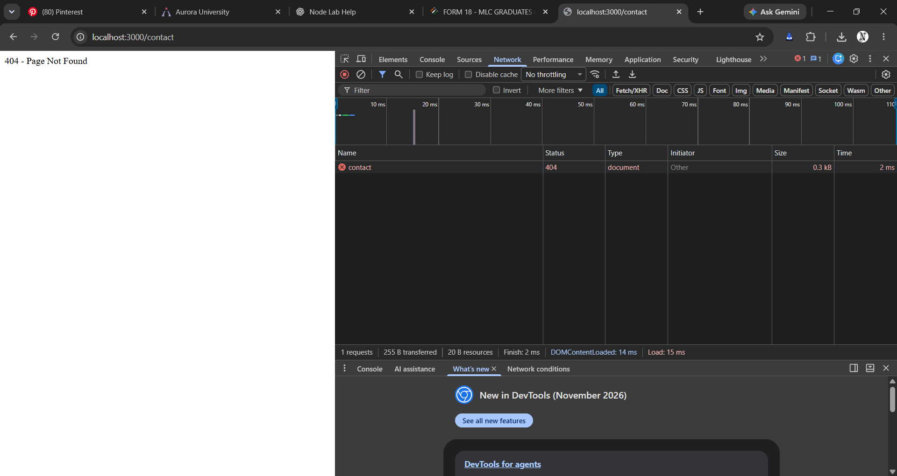

# Lab 1: Node.js and Express Server

## Student Details

* Name: Syed Noman Ali
* Registration Number: [252U1R9154]
* Section: 112 (CSE Gen-AI)
* Course: Backend Development Fundamentals

## Objective

To set up a Node.js project and build a web server using the built-in HTTP module and Express.js framework.

## Technologies Used

* Node.js
* Express.js
* JavaScript
* Visual Studio Code

## Installation and Execution

### 1. Clone the repository

```bash
git clone YOUR_REPOSITORY_URL
```

### 2. Navigate to the project folder

```bash
cd lab-01
```

### 3. Install dependencies

```bash
npm install
```

### 4. Run the HTTP server

```bash
node server.js
```

### 5. Run the Express server

```bash
node express-server.js
```

Open your browser at:

`http://localhost:3000`

## API Endpoints

| HTTP Method | Endpoint | Description                          | Status |
| ----------- | -------- | ------------------------------------ | ------ |
| GET         | /        | Displays welcome message             | 200    |
| GET         | /about   | Displays student information in JSON | 200    |
| GET         | /time    | Displays current date and time       | 200    |
| GET         | /contact | Returns custom 404 error             | 404    |

## Screenshots

## Output Screenshots

### 1. Node.js HTTP Server


### 2. Express Server


### 3. About Route


### 4. Time Route


### 5. 404 Error Handling


## Problems Faced and Solutions

1. Initially, the server did not execute because of an incorrect filename in the terminal command. This was resolved by using the correct command.
2. JavaScript code was accidentally entered in PowerShell instead of the JavaScript editor. This was corrected by adding the code to express-server.js.
3. Browser caching affected the status code verification. This was resolved by enabling Disable cache in Chrome Developer Tools.

## Result

Successfully created a Node.js HTTP server and an Express.js server with three GET endpoints and custom 404 error handling. All endpoints were tested successfully using a web browser.
